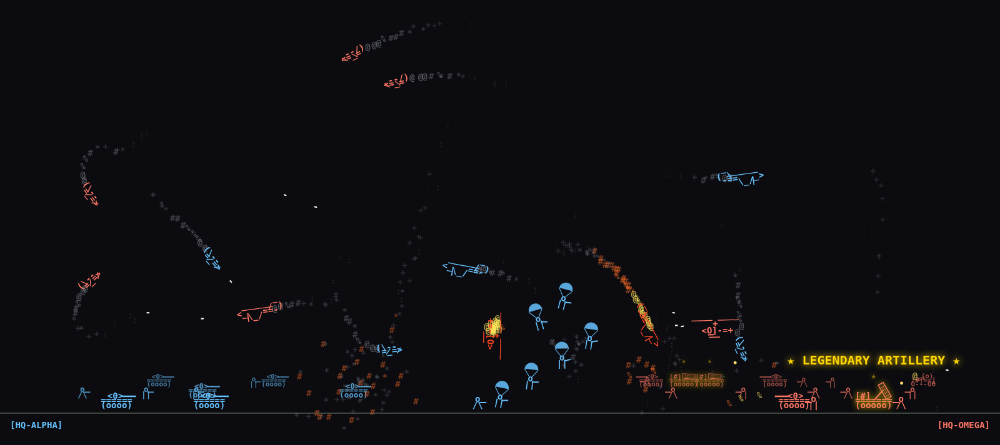
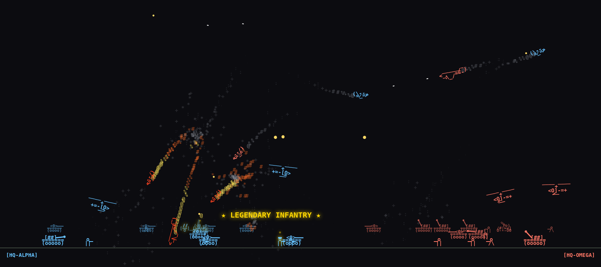

# ASCII Battleground

An auto-battler drawn entirely in ASCII art on an HTML5 canvas. Two armies (blue **HQ-ALPHA** and red **HQ-OMEGA**) clash across three lanes with infantry, tanks, anti-air, artillery, fighters, bombers and helicopters. Units that rack up kills are promoted to **legends** and gain new weapons. You can watch the fight or take control of an aircraft yourself.

Written in plain JavaScript, with no frameworks, no build step and no dependencies.

**[▶ Play in the browser](https://tarold.github.io/Battleground/)**. A desktop browser is recommended because player mode uses the mouse and keyboard.





## Features

- **Seven unit types with distinct behaviour.**
  - Infantry goes prone under fire, crawls forward and switches to an RPG against vehicles.
  - Tanks, anti-air vehicles and self-propelled artillery fire ballistic shells.
  - Fighters dogfight and hunt bombers first, bombers fly carpet-bombing runs, and helicopters hover over the frontline with a minigun turret.
- **Legend system.** Kills are credited through projectiles and area damage. Once a unit reaches its threshold it is promoted with a slow-motion effect and a banner, then gains a perk:

  | Unit | Legendary perk |
  | :--- | :--- |
  | Infantry | Radios in a transport plane that drops paratroopers |
  | Tank | Becomes a heavy tank whose shells pierce the first enemy |
  | Anti-air | Fires homing missile salvos |
  | Artillery | Becomes a rocket launcher with a 6-rocket salvo |
  | Fighter | Gains homing rockets and instant target lock |
  | Bomber | Drops a nuke and repairs itself in flight |
  | Helicopter | Fires unguided rocket salvos |

- **Physics and ballistics.** Artillery and RPG arcs are solved for range, rockets home in and retarget when they miss, planes steer with turn rates and wobble, and shot-down aircraft crash and damage the ground below.
- **Player mode.** Take control of a fighter, a bomber or a helicopter and fly with the mouse.
- **Live tuning.** Sliders set unit caps per type, and a scoreboard tracks kill progress toward legend status.
- **Effects.** Smoke trails, explosions, parachutes, radio waves, screen flashes and slow motion on promotions.

## Controls

| Key | Action |
| :--- | :--- |
| `F1` | Show shortcuts |
| `1` | Toggle the scoreboard (best kills per unit type vs. kills needed for legend) |
| `2` | Toggle the settings panel (unit count sliders) |
| `3` | Cycle player mode: fighter → bomber → helicopter → off |
| Mouse | Fly toward the cursor (the helicopter aims its turret at it) |
| Left click | Machine gun |
| Right click | Fighter: rockets · bomber: bombs or nuke · helicopter: rocket salvo (legend weapons) |

## Running

Play online at **https://tarold.github.io/Battleground/**, or run it locally. There is nothing to install: clone the repository and open `index.html` in a browser.

```bash
git clone https://github.com/Tarold/Battleground.git
cd Battleground
xdg-open index.html        # macOS: open index.html · Windows: start index.html
```

## Architecture

The game is about 4,500 lines of vanilla ES6, split into modules by responsibility and loaded with plain `<script>` tags. Load order matters.

| File | Responsibility |
| :--- | :--- |
| `js/config.js` | Canvas, world geometry and every balance constant (`UNIT_STATS`, `PLANE_STATS`, weapon tunables) |
| `js/movement.js` | Pure math and physics: ground movement, ballistics, homing, aircraft steering, parachutes |
| `js/art.js` | Drawing only: ASCII sprites for units, planes and UI overlays |
| `js/effects.js` | Smoke, explosions, banners, area damage |
| `js/projectile.js` | Bullets, shells, bombs, rockets and missiles: flight, hit tests, detonation |
| `js/ground-unit.js` | Ground units: targeting, firing, RPGs, airdrop calls, legend perks |
| `js/plane.js`, `js/helicopter.js`, `js/airdrop.js` | Aircraft AI, player control, transport plane |
| `js/battle.js` | Spawners, the update/render loop, resizing |
| `js/player.js`, `js/settings.js`, `js/help.js` | Player input, settings panel, help overlay |

Design choices:

- **Strict separation of concerns.** Physics lives in `movement.js` and drawing in `art.js`. Each entity owns its own state and behaviour.
- **Object pooling.** Smoke particles, projectiles, ground units and airdrops are reused, so the hot loop does not allocate.
- **Data-driven balance.** All numbers live in `config.js`, and legend perks are declared per unit type and read through a `perk` getter.
- **Single damage pipeline.** Every kill goes through `Projectile.fire`, then `detonate`, then `damageArea` or `damagePlanesArea`, and is credited to the shooter.

See [docs/ARCHITECTURE.md](docs/ARCHITECTURE.md) for the per-file API.

## Tech stack

JavaScript (ES6 classes, `'use strict'`) · HTML5 Canvas 2D · CSS. No libraries.
